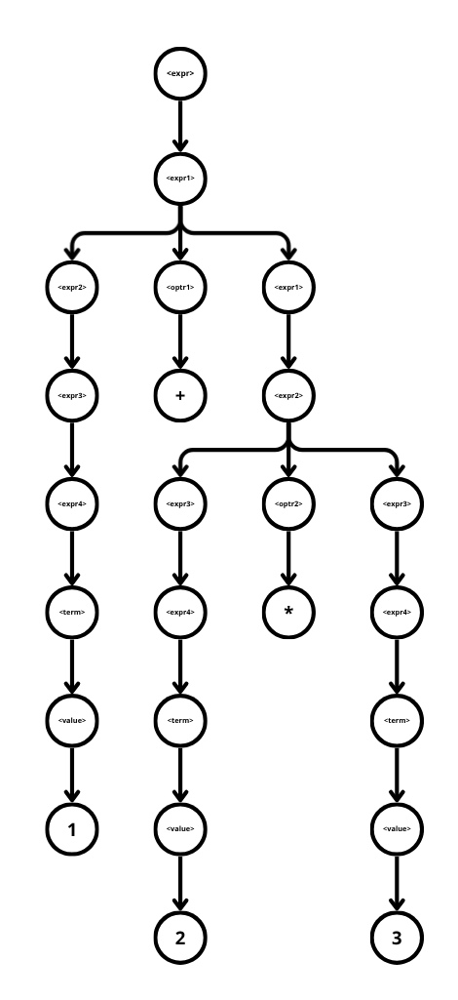
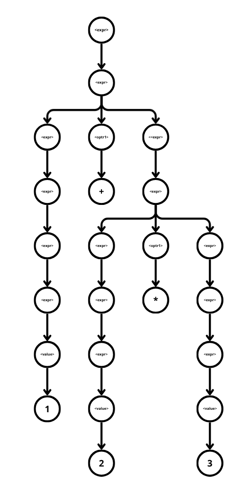
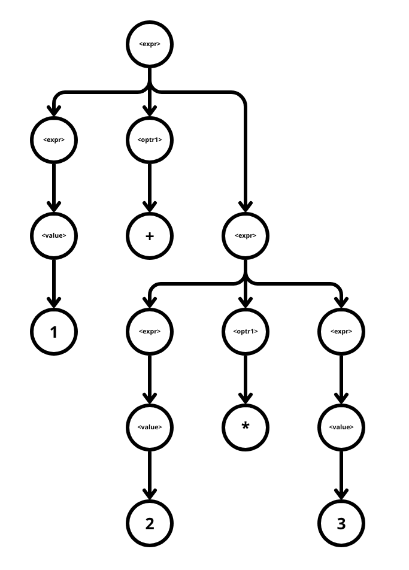
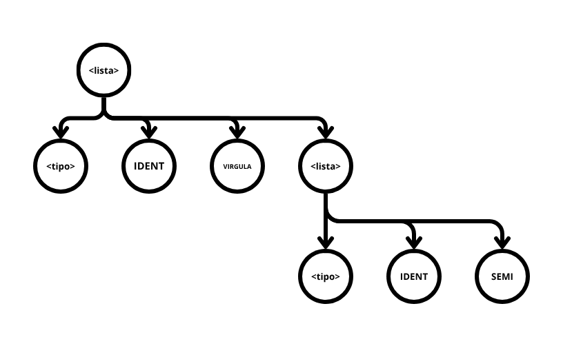
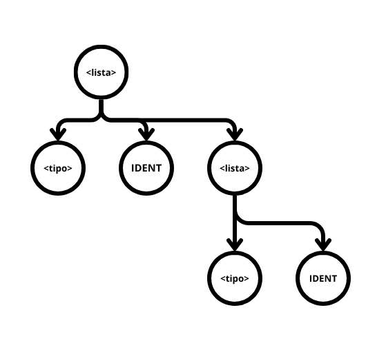
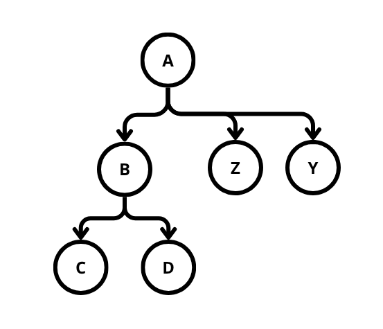
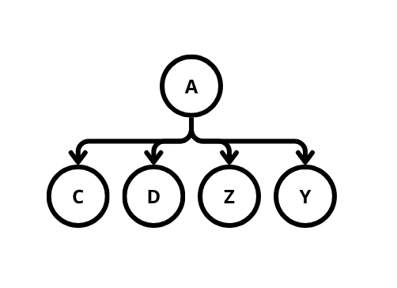
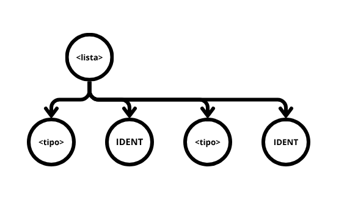
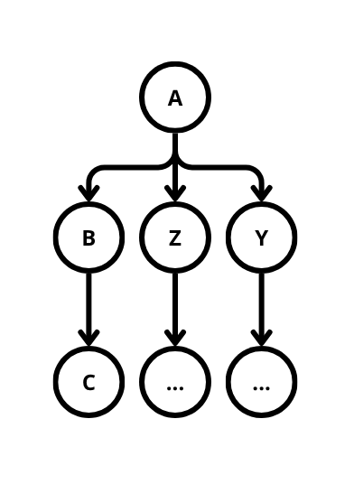
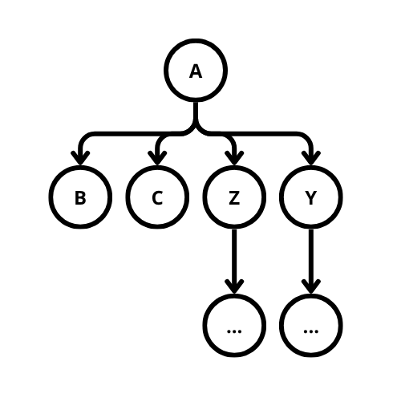

# Árvore Sintática em Memória

O Web GALS vêm com uma biblioteca para ajudar na criação e manipulação de árvores sintáticas 
em memoria. Nomeada **BibAST**, esta permite o desenvolvimento de compiladores com uma metodologia
baseada em transformações recursivas.

> [!WARNING]
> A biblioteca ainda está em desenvolvimento e atualmente não tem suporte a Delphi.
> A API esta sujeita a mudar até novembro de 2026.

## Árvore abstrata

Tradicionalmente o processamento semântico e geração de código feito por um compilador
acontece via o uso das ações semânticas; identificadores numéricos presentes na gramática que
realizam *callbacks* a funções no compilador quando identificadas pelo analisador sintático
(no Web GALS tais funções sendo escritas dentro do método `executeAction()` da classe Semântico).

Este método é simples na implementação, porém restringe a complexidade do compilador já
que em nenhum momento da compilação o compilador tem acesso completo a árvore sintática
derivada pelo analisador sintático.

De fato, no uso das ações semânticas não só se limita as informações disponíveis ao compilador
(somente Tokens associados a uma ação semântica são enviados à classe Semântica), como conjuntos
de informações outrora sequenciais são quebrados em múltiplas chamadas de função (como no caso de lista de
identificadores em uma chamada de função, ou uma expressão binária).

Uma alternativa ao uso do sistema de ações semânticas é guardar a árvore sintática
derivada pelo analisador sintático na memoria e processa-la posteriormente. Esta árvore
dada pelo analisador denomina-se **Árvore Sintática Concreta**, já que ela representa precisamente
o que o analisador aceitou. No momento que se modifica uma árvore sintática concreta, ela se torna
uma **Árvore Sintática Abstrata** (*AST*), já que ela representa o programa, mas não necessariamente
o que o analisador sintático aceitou.

O Web GALS suporta na sua geração de código uma biblioteca para a criação e manipulação de árvores sintáticas
abstratas, com múltiplas transformações pré implementadas prontas ao uso.

> [!NOTE]
> A biblioteca vem desativada por padrão, e é ativada no menu de configurações do Web GALS na secção sintática.

---

Ao habilitar a biblioteca, a função `parse()` da classe Sintático para de executar as ações semânticas e passa
a retornar a árvore sintática. Por questões de compatibilidade, caso a gramática possua ações semânticas, essas
são postas na árvore concreta em suas devidas posições, na qual podem ser processadas da maneira tradicional
posteriormente via uma *transformação*:

```C++
try {
	auto tree = syn.parse(&lex);
	Node::transform(tree, [&sem](auto& n) {
		auto kind = n->getKind();
		if (kind.first == NodeKind::SemanticAction) {
			auto actlex = n->getActionLex();
			auto a = std::get<int>(kind.second);
			sem.executeAction(a + 1, actlex);
		}
	});
	tree.printTree(0);
} catch ( ... ) {
	...
}
```
<center><i>Exemplo C++.</i></center>

```rust
let mut tree = syn.parse()?;
tree.try_transform(&mut |n| {
	if let NodeKind::SemanticAction(a) = n.get_kind() {
		sem.execute_action((*a + 1) as u32, n.get_actionlex().expect("token"))?;
	};
	Ok(())
})?;
tree.print_tree(0);
```
<center><i>Exemplo Rust.</i></center>

```java
try {
	var tree = syn.parse(lex);
	tree.tryTransform(n -> {
		var kind = n.getKind();
		if (kind instanceof Node.NodeKind.SemanticAction a) {
			var actlex = a.lex();
			var action = a.action();
			sem.executeAction(action, actlex);
		}
	});
	tree.printTree(0);
} catch ( ... ) {

}
```
<center><i>Exemplo Java.</i></center>

```python
try:
	tree = syn.parse(lex)

	def trns(n):
		(nkind, ndata) = n.kind
		if nkind == NodeKind.SemanticAction:
			actlex = ndata.actionlex
			action = ndata.action
			sem.execute_action(action, actlex)

	tree.transform(trns)
	tree.print_tree(0);
except ...:
	pass
```
<center><i>Exemplo Python.</i></center>

Transformações são o coração desta metodologia. Uma transformação é uma função executada em todos os nós da
árvore seguindo uma ordem específica (a transformação acima sendo pós-ordem em profundidade).

Com o uso das transformações é possível simplificar e reorganizar a árvore abstrata, adicionar informações
a ela (como informações de tipagem), ou até mesmo usa-la de referência para a geração de código.

## Classe Node

A classe `Node` é a classe que representa os nós da árvore abstrata, e é o tipo retornado pela função `parse()`.
De dados, elas possuem o parâmetro `kind`, a variante (*tagged union*/*enum*) de que tipo de nó é esse, tendo quatro
opções: terminal, não-terminal, ação semântica e nó customizado; e `children`, sua lista de filhos. Métodos estão
disponíveis para acessar e modificar ambos.

> [!NOTE]
> Devido a grande quantidade de código presente nesta classe, vezes quatro, uma para cada implementação, 
> peço que busquem protótipos de funções para manipulação desta classe no próprio código fonte dos arquivos gerados.

## Transformações Prontas

A biblioteca vem com seis transformações parametrizáveis que permitem modificar a árvore, no intuito de simplifica-la
para visualização e posterior processamento.

#### Transformção `assimilate`

Protótipo `assimilate(newkind: NodeKind, similars: List<NodeKind>)`.

Esta transformação ira percorrer a árvore procurando por
nós que se assemelham a qualquer `NodeKind` presente em `similars` e, caso ache, os morfará para `newkind`. Esta
transformação é útil para padronizar nós que representam a mesma informação. Por exemplo, dado a gramática:
```
<expr>  ::= <expr1>;
<expr1> ::= <expr2> | <expr2> <optr1> <expr1>;
<expr2> ::= <expr3> | <expr3> <optr2> <expr2>;
<expr3> ::= <expr4> | <expr4> <optr3> <expr3>;
<expr4> ::= <term>  | <term>  <optr4> <expr4>;
<optr> ::= ...;
...
<term>  ::= <value> | OPEN <expr> CLOSE;
```
as regras `<expr>`, `<expr1>`, `<expr2>`, `<expr3>`, `<expr4>` e `<term>` representam as mesmas informações, mas necessitam 
ser não-terminais diferentes por questões de precedência e ambiguidade. As regras de operador sofrem um problema parecido.
as transformações `assimilate(<expr>, [<expr1>, <expr2>, <expr3>, <expr4>, <term>])` e transformação `assimilate(<optr1>, [<optr1>, <optr2>, <optr3>, <optr4>])`
irão tornar a seguinte árvore de derivação, que corresponde ao programa "`1 + 2 * 3`":

<center></center>
<center><i>Exemplo pré transformação assimilate.</i></center>

na seguinte árvore abstrata:

<center></center>
<center><i>Exemplo pós transformação assimilate.</i></center>

onde todos os não-terminais `<expr1>`, `<expr2>`, `<expr3>`, `<expr4>` e `<term>` foram substituidos por `<expr>`, e todos os
operadores por `<optr1>`.

> [!NOTE]
> A função `assimilate()`, e todas as transformações prontas, esperam argumentos do tipo NodeKind. Por exemplo,
> em Rust, a transformação acima (referente as expressões) seria escrita da seguinte forma:
> ```
> tree.assimilate(NodeKind::NonTerminal(NonTerm::nt_expr), &[
> 	NodeKind::NonTerminal(NonTerm::nt_expr1),
> 	NodeKind::NonTerminal(NonTerm::nt_expr2),
> 	NodeKind::NonTerminal(NonTerm::nt_term),
> ])
> ```
> A enumeração `NonTerm` está disponível no arquivo de constantes gerado com o projeto, junto com `TokenId` para terminais.
> 
> Para C++, o tipo `NodeKind` é quebrado em duas partes, onde funções como a anterior aceitam `std::pair<NodeKind, NodeData>` no lugar
> de `NodeKind`, com `NodeKind` sendo uma enumeração e `NodeData` sendo um `std::variant` com os dados da enumeração, por exemplo:
> ```
> Node::assimilate(
>   tree,
>   std::make_pair(NodeKind::NonTerminal, NonTerm::nt_expr),
>   std::vector<std::pair<NodeKind, NodeData>> {
>     std::make_pair(NodeKind::NonTerminal, NonTerm::nt_expr1),
>     std::make_pair(NodeKind::NonTerminal, NonTerm::nt_expr2),
>     std::make_pair(NodeKind::NonTerminal, NonTerm::nt_term ),
>   }
> );
> ```
>
> Para Python é usado uma tupla, e para Java `NodeKind` é uma interface selada que emula
> uma enumeração estilo Rust.

#### Transformação `squash`

Protótipo `squash(target: NodeKind)`.

Esta transformação procura por nós similares a `target` nos quais tem somente
um nó filho e, caso o seu nó filho tenha o mesmo nodekind que seu pai, o filho é deletado, com os netos sendo transferidos para
o pai, eg.: `A tem B tem C,D,E → A tem C,D,E; B deletado`. Esta transformação é util em uso conjunto com a transformação anterior
para deletar nós reduntantes na árvore. Por exemplo, digamos que as padronizações de expressão anteriores foram executadas:
há uma grande chance que "cadeias" de `<expr>` aninhadas umas dentro das outras tenham sido formadas. A transformação `squash()` ira
"esmagar" estas cadeidas em um nó só. A figura abaixo exemplifica:

<center></center>
<center><i>Exemplo pós transformação squash sobre o exemplo anterior.</i></center>

#### Transformação `filter`

Protótipo: `filter(target: NodeKind, removelist: List<NodeKind>)`.

Esta transformação remove qualquer filho de `target` que esteja presente 
em `removelist`. Ela é útil para remover terminais que não apre­sentam significado semântico após a analise sintática, como pontos-vírgula
ou parênteses. Por exemplo, em uma lista de identificadores associados a tipos, é muito provavel que os elementos sejam separados por
vírgula, ou algo similar, porém somente os identificadores e os tipos apresentam significado semântico. 

Dado a seguinte gramatica:

```
<lista> ::= <tipo> IDENT SEMI | <tipo> IDENT VIRGULA <lista>;
```

e a seguinte derivação desta gramática:

<center></center>
<center><i>Exemplo pŕe transformação filter.</i></center>

executar:

```C++
Node::filter(
	tree,
	std::make_pair(NodeKind::NonTerminal, NonTerm::nt_lista),
	std::vector<std::pair<NodeKind, NodeData>> {
		std::make_pair(NodeKind::Terminal, new Token(TokenId::t_VIRGULA, "", 0)),
		std::make_pair(NodeKind::Terminal, new Token(TokenId::t_SEMI, "", 0)),
	}
)
```

> [!NOTE]
> No C++, todas as transformações efetuam `delete` dos `Tokens*` recebidos via argumento.

irá remover as virgulas e pontos-vírgulas da árvore abstrata:

<center></center>
<center><i>Exemplo pós transformação filter.</i></center>

#### Transformação `flatten`

Protótipo: `flatten(target: NodeKind)`.

Esta transformação é usada para deletar um nó, trocando-o por seus filhos.
Por exemplo, se um nó A tem um nó B, no qual o nó B tem filhos C e D, executar
flatten(B) deletará B e fará com que C e D sejam filhos de A, eg.:

<center></center>
<center><i>Exemplo pré transformação flatten.</i></center>

vira

<center></center>
<center><i>Exemplo pós transformação flatten.</i></center>

#### Transformação `enlistify`

Protótipo: `enlistify(target: NodeKind)`.

Esta transformação é usada para linearizar listas recursivas. Ela checa
se o nó raiz e seu último filho tem o mesmo tipo e, se for esse o caso, executa
`flatten()` em tal filho.

Por exemplo, se pegarmos [o exemplo da transformação `filter()`](#transformação-filter) e executarmos `enlistify(<lista>)` o resultado será:

<center></center>
<center><i>Exemplo pós transformação enlistify.</i></center>

#### Transformação `raise`

Protótipo: `raise(dest: NodeKind, src: NodeKind)`.

Esta transformação é usada para promover um nó de neto à filho. Se o nó A tem um filho B, 
onde o filho B tem um filho C, o filho C é removido de B e adicionado aos filhos de A, 
ao chamar `raise(B, C)`. Diferente de `flatten()`, B não é deletado.

Dado esta derivação:

<center></center>
<center><i>Exemplo pré transformação raise.</i></center>

executar `raise(B, C)` resultará em:

<center></center>
<center><i>Exemplo pós transformação raise.</i></center>

## Transformações Customizadas

As transformações são implementadas via a chamada do método correspondente em qualquer nó da árvore,
dando uma função lambda como argumento (que realizará a operação da transformação). A função lambda em sí
recebe um único argumento: o nó que está sendo atualmente processado. A função de transformação então irá
percorrer todos os nós filhos do nó na qual a transformação foi iniciada, executando a função lambda fornecida
tendo eles de argumento.

O primeiro e principal método de transformação fornecida é  `transform(t)`, específicada com código o
Rust abaixo:

```rust
pub fn transform<F>(self: &mut Box<Self>, t: &mut F)
where
	F: FnMut(&mut Box<Self>),
{
	self.children.iter_mut().for_each(|c| c.transform(t));
	t(self);
}
```

| Linguagem | Protótipo | Versão Try? |
|-----------|-----------| ----------  |
| C++       | <pre>static void transform(std::unique_ptr&lt;Node&gt;& self, std::function&lt;void(std::unique_ptr&lt;Node&gt;&)&gt; t)</pre> | Não |
| Java      | <pre>public void transform(Consumer&lt;Node&gt; t)</pre>                                                            | <span style="text-justify: none;">Sim, lança <pre style="font-size: 13pt;">AnalysisError</pre></span> |
| Python    | <pre>def transform(self, t)</pre>                                                                                   | Não |
| Rust      | <pre>pub fn transform&lt;F&gt;(self: &mut Box&lt;Self&gt;, t: &mut F) where F: FnMut(&mut Box&lt;Self&gt;)</pre>   | <span style="text-justify: none;">Sim, retorna <pre style="font-size: 13pt;">Result&lt;(), AnalysisError&gt;</pre></span> |

Esta função percorre a árvore _em profundidade_ com chamada _pós ordem_, ou seja, nós mais profundos primeiro, com
a sua função lambda sendo executada após chegar ao final da cadeia de nós, ou "na volta".

A função `transformPreorder(t)` também é em profundidade, mas executa _pré ordem_, ou seja, executa "na ida":
```rust
pub fn transform_preorder<F>(self: &mut Box<Self>, t: &mut F)
where
	F: FnMut(&mut Box<Self>),
{
	t(self)
	self.children.iter_mut().for_each(|c| c.transform_preorder(t));
}
```
| Linguagem | Protótipo |
|-----------|-----------|
| C++       | <pre>static void transformPreorder(std::unique_ptr&lt;Node&gt& self, std::function&lt;void(std::unique_ptr&lt;Node&gt&)&gt; t)</pre> |
| Java      | <pre>public void transformPreoder(Consumer&lt;Node&gt; t)</pre>                                                            |
| Python    | <pre>def transform_preorder(self, t)</pre>                                                                                   |
| Rust      | <pre>pub fn transform_preorder&lt;F&gt;(self: &mut Box&lt;Self&gt;, t: &mut F) where F: FnMut(&mut Box&lt;Self&gt;)</pre>   |

A função `transformDual(t)` executa a lambda duas vezes, uma vez pré ordem e outra pós ordem. Tal operação é necessária
para a correta implementação da tipagem e escopagem do programa, já que importa para implementação de ambos se você 
esta "entrando" ou "saindo" de um nó.

```rust
pub fn transform_dual<F>(self: &mut Box<Self>, t: &mut F)
where
	F: FnMut(&mut Box<Self>, bool),
{
	t(self, false);
	self.children.iter_mut().for_each(|c| c.transform_dual(t));
	t(self, true);
}
```
| Linguagem | Protótipo |
|-----------|-----------|
| C++       | <pre>static void transformDual(std::unique_ptr&lt;Node&gt& self, std::function&lt;void(std::unique_ptr&lt;Node&gt&, bool)&gt; t)</pre> |
| Java      | <pre>public void transformDual(BiConsumer&lt;Node, Boolean&gt; t)</pre>                                                            |
| Python    | <pre>def transform_dual(self, t)</pre>                                                                                   |
| Rust      | <pre>pub fn transform_dual&lt;F&gt;(self: &mut Box&lt;Self&gt;, t: &mut F) where F: FnMut(&mut Box&lt;Self&gt;, bool)</pre>   |


A versões de C++ dessas funções são métodos estáticos devido ao fato de que o C++ não permite especializar a variável `this`
a qualquer tipo além de `T*`, porém o design da biblioteca requer um valor boxeado `std::unique_ptr<T>` como valor `this`, eg.:

```C++
// Equivalente C++ de transform(t)
static void transform(std::unique_ptr<Node>& self, std::function<void(std::unique_ptr<Node>&)> t);
// Então é chamada com
Node::transform(no, ...);
/* Ao invéz de
no->transform(...);
*/
```

## Nós Customizados

A enumeração `NodeKind` contém uma quarta opção chamada `CustomNode` que permite a inserção de
nós customizados na árvore abstata. Similar a classe Semântico, a classe `CustomNode` é uma classe
vazia na qual é esperado que o usuário implemente. O usuário está livre para usar
a classe `CustomNode` para o que bem quiser, mas é recomendado o seu uso para adicionar informações
de tipagem na árvore para o uso de algorítmos de inferencia automática de tipos, 
[como os Algoritmos W, F e Fω, por exemplo](https://sdiehl.github.io/typechecker-zoo/),
ou até mesmo para fazer a linearização de trechos de códigos para código intermediário sem emitir-los
diretamente ao programa final.

**Esqueletos das classes:**

```c++
class CustomNode {
public:
    std::string to_string(void) const;
    bool operator==(const CustomNode& rhs) const;
};
```
<center><i>Classe C++.</i></center>

---

```java
public class CstmNode {
	@Override
	public String toString() {
		return "#CUSTOM";
	}

	@Override
	public boolean equals(Object o) {
		return true;
	}

	@Override
	public int hashCode() {
		return 0;
	}
}
```
<center><i>Classe Java.</i></center>

---

```python
class CustomNode:
	def __eq__(self, other):		
		return True
	def __str__(self):		
		return "#CUSTOM"
```
<center><i>Classe Python.</i></center>

---

```rust
#[derive(Debug, Clone, PartialEq)]
pub struct CustomNode {}

#[allow(unused)]
impl CustomNode {
    pub fn new() -> Self {
        CustomNode {}
    }
}

impl Display for CustomNode {
    fn fmt(&self, f: &mut std::fmt::Formatter<'_>) -> std::fmt::Result {
        write!(f, "(custom)")
    }
}
```
<center><i>Classe Rust.</i></center>

---

A maneira mais fácil de se inserir um nó customizado na árvore abstrata é via uma transformação.
Por exemplo, a seguinte transformação irá buscar por um não-terminal XYZ e irá o substituilo
por um nó customizado via função `morph()` (função que troca o kind de um nó) (em Java).

```java
tree.transform(n -> {
	if (n.isSimilar(new Node.NodeKind.NonTerminal(NonTerm.nt_XYZ))) {
		var c = new Node.NodeKind.CustomNode(new CstmNode());
		n.morph(c);
	}
});
```
